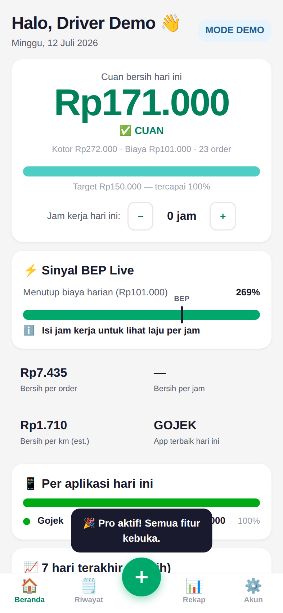
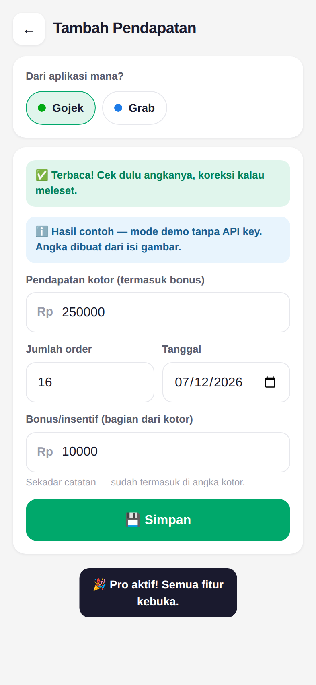
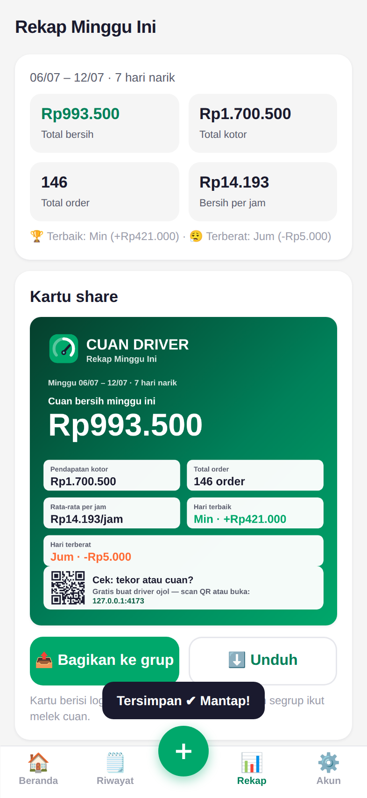
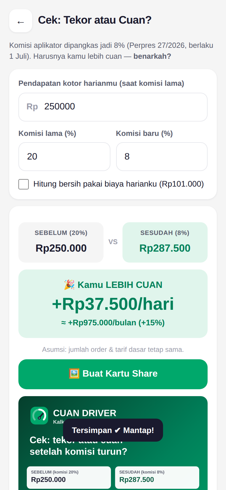

# 🏍️ Cuan Driver

**Cek: tekor atau cuan?** — Kokpit laba-rugi (P&L) untuk driver ojol Indonesia.

Drivers see gross earnings; after fuel, meals, installments, and fees many are
actually losing money. Cuan Driver shows the **real net profit** — per day, per
order, per km, per hour — across Gojek, Grab, Maxim, and inDrive in one
offline-first PWA, with AI screenshot capture so nobody has to type numbers
after a 12-hour shift.

| Dashboard (cockpit) | AI scan confirm | Weekly recap share card | Viral calculator |
| --- | --- | --- | --- |
|  |  |  |  |

## Features

- **Screenshot-based income capture** — photograph the app's earnings screen;
  Claude Vision extracts gross, order count, and incentives (2 taps, no typing).
  Without an API key the endpoint runs a deterministic **mock parser**, so the
  whole product is demoable at zero cost.
- **Multi-app merge** — one dashboard for Gojek/Grab/Maxim/inDrive, color-coded.
- **True P&L math** — costs set up once (fuel per km/day, meals, cigarettes,
  bike installment ÷ work days, service, data quota); net per day/order/km/hour.
- **Live break-even (BEP) signal** — Rp/hour pace vs the break-even threshold:
  "gas terus" or "mending pulang".
- **Before/after policy calculator** — the Perpres 27/2026 commission-cut
  check (20% → 8%): "benarkah kamu lebih cuan?" with a shareable result card.
- **Weekly recap card** — canvas-rendered 1080px PNG with stats + QR install
  link, built for WhatsApp/Facebook groups (the distribution engine).
- **Freemium** — free: 1 app, manual logging, today's net, calculator, 3 AI-scan
  trials. Pro (Rp15k/mo · Rp99k/yr): unlimited AI scan, multi-app, live BEP,
  recap cards, CSV export. Payment via QRIS/WhatsApp → license code (no app
  store cut). Referral: both sides get 7 days of Pro.
- **Offline-first** — localStorage is the source of truth; an outbox queue
  syncs idempotently when signal returns. Installable PWA (no Play Store).

## Stack

```
PWA        React 18 + Vite (hash-routed SPA, ~75KB gzip JS), hand-written SW
Backend    Cloudflare Workers + Hono
Database   Cloudflare D1 (SQLite) — schema in migrations/
Storage    Cloudflare R2 (screenshots, optional binding)
AI         Anthropic Claude Vision (@anthropic-ai/sdk), default model
           claude-haiku-4-5 (cheap by design), structured JSON output,
           SHA-256 scan cache, full mock mode without a key
Auth       Email/password (PBKDF2-SHA256 100k) + HS256 JWT (30 days)
Shared     shared/ — P&L math, calculator, license codes, mock parser:
           ONE source of truth imported by both Worker and PWA
```

## Quickstart (local)

```bash
npm install
cp .dev.vars.example .dev.vars          # optional: fill ADMIN_TOKEN etc.
npx wrangler d1 migrations apply cuan-driver-db --local
npm run dev                             # build PWA + wrangler dev → http://localhost:8787
```

Hot-reload frontend development (proxies /api to wrangler):

```bash
npm run dev        # terminal 1 — API on :8787
npm run dev:web    # terminal 2 — Vite on :5173
```

No `ANTHROPIC_API_KEY`? Everything still works — AI scan returns deterministic
mock results labeled "mode demo". Add the key to `.dev.vars` for real parsing.

**Demo license code:** `CUAN-DEMO-2026` (accepted when `DEMO_MODE=true`) — 7 days Pro.

## Tests

```bash
npm test           # 59 vitest tests: P&L math + full API integration
                   # (real Hono app over in-memory SQLite via a D1 shim)
npm run typecheck  # strict TS, web + worker projects
npm run build:demo && npm run e2e
                   # 16 Playwright checks on a mobile viewport: wizard math,
                   # dashboard net math, scan flow, paywall, share cards,
                   # offline add + reload persistence
```

## Standalone demo (no server, no key)

```bash
npm run build:demo
# → dist/demo/cuan-driver-demo.html — ONE self-contained file. Open it anywhere.
```

Demo mode runs the entire API in-browser (mock), seeds a realistic week of
earnings, and unlocks Pro with `CUAN-DEMO-2026`.

## Deploying to Cloudflare

See **[docs/DEPLOYMENT.md](docs/DEPLOYMENT.md)** — D1/R2 creation, secrets
(`JWT_SECRET`, `ADMIN_TOKEN`, `ANTHROPIC_API_KEY`), `npm run deploy`, and the
license-code fulfillment runbook. API reference for future mobile clients:
**[docs/API.md](docs/API.md)**.

Admin dashboard: `https://<your-app>/admin` (requires `ADMIN_TOKEN`).

## Project layout

```
shared/     domain logic used by client AND server (math never drifts)
worker/     Hono API (auth, earnings, scan, licenses, admin)
web/        PWA (screens, offline store+sync, share cards, SW, admin UI)
migrations/ D1 schema
scripts/    icon generator, demo inliner, Playwright e2e
test/       vitest unit + API integration (D1 shim over better-sqlite3)
docs/       API reference, deployment guide, screenshots
```

## Product decisions & assumptions

- **Model choice:** scan defaults to `claude-haiku-4-5` per the spec's
  cost-awareness requirement; override with `ANTHROPIC_MODEL`. Identical
  screenshots are cached by hash and never billed twice; clients compress to
  ≤1280px JPEG before upload (~Rp40–70 per real scan).
- **Free→Pro mapping** (per spec): free = manual single-app + today's net +
  calculator (plus 3 AI-scan trials as a teaser); Pro = AI scan, multi-app,
  live BEP, recap cards, export.
- **QRIS flow is manual for MVP:** pay → send proof via WhatsApp → admin sends
  a license code (generated in /admin). Swap in a payment provider later
  without touching the license system.
- **Incentives** are recorded as informational — `gross_amount` already
  includes them (matches how the apps display "pendapatan").
- **Dates** are driver-local `YYYY-MM-DD` strings (WIB default), computed on
  the device — no UTC off-by-one on earnings days.
- **Hours worked today** live on-device (dashboard stepper); they feed the BEP
  pace and per-hour stats.
- **Cloudflare Queues** from the original spec is not needed at MVP scale
  (scan is a single synchronous call); noted as a future async path.
- Leaderboard is stubbed (`501`) — flagged v2 in the spec.

## Privacy

Driver data belongs to drivers. No data selling; any future lead-gen
(insurance/BPJS/parts offers) must be opt-in. Passwords hashed (PBKDF2-SHA256),
screenshots stored privately in R2 under the owner's user id.
